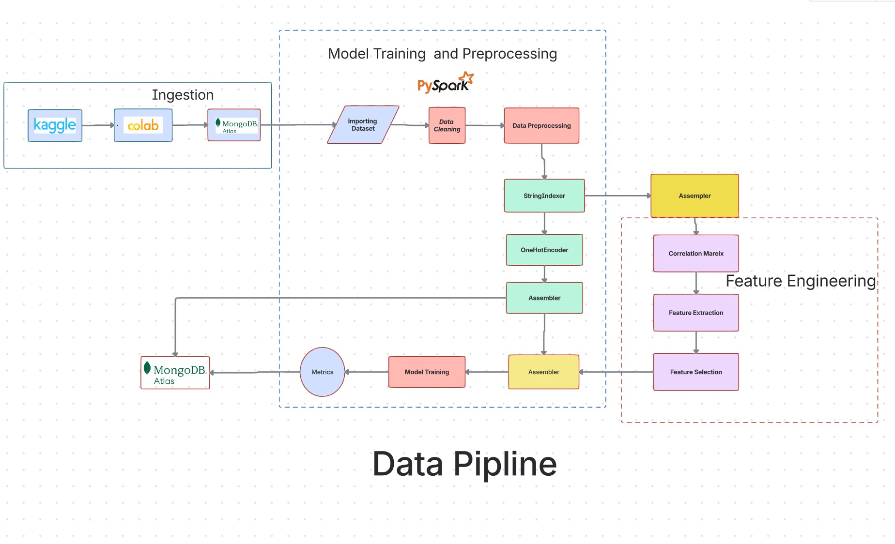
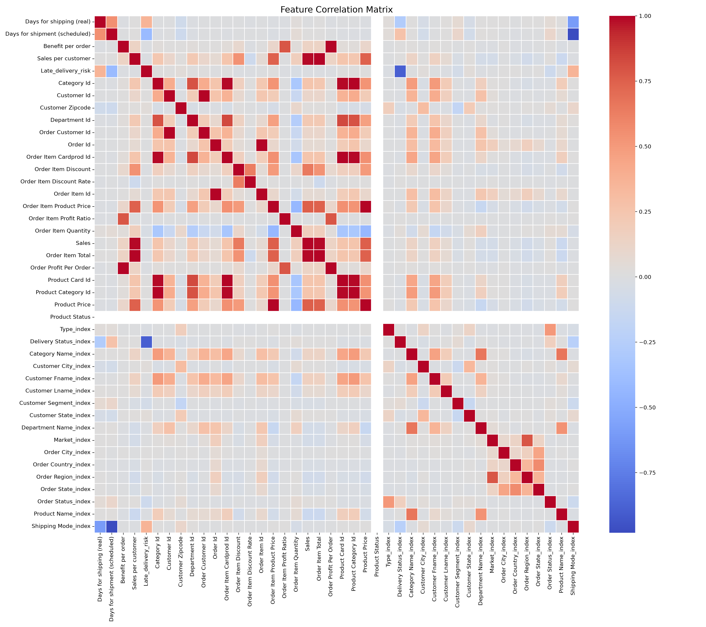
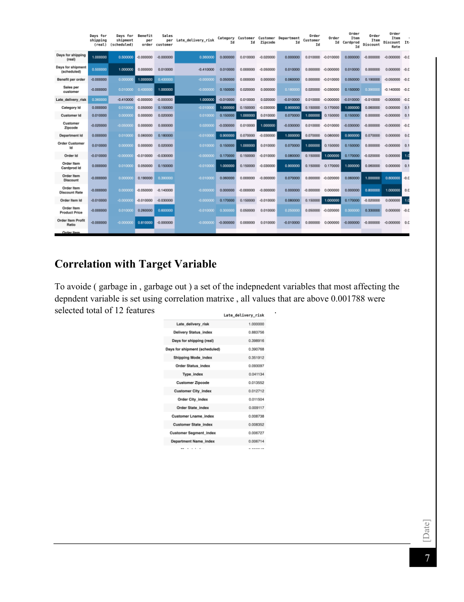
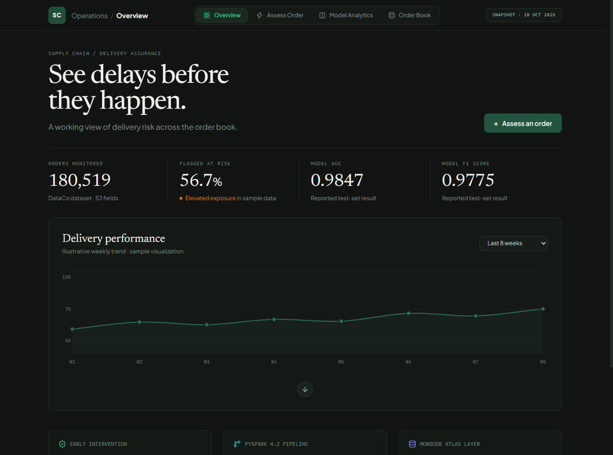
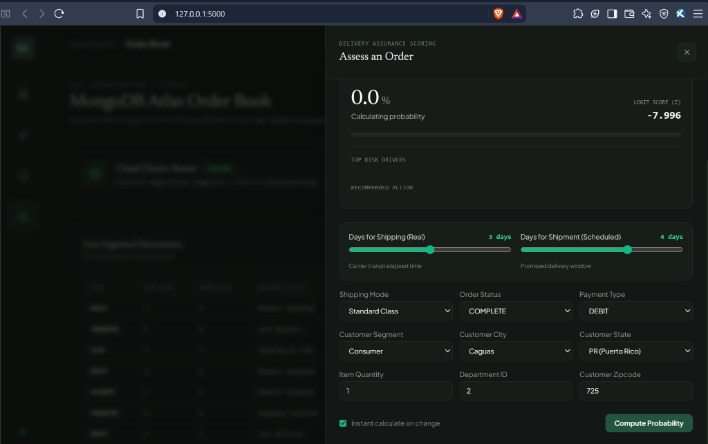
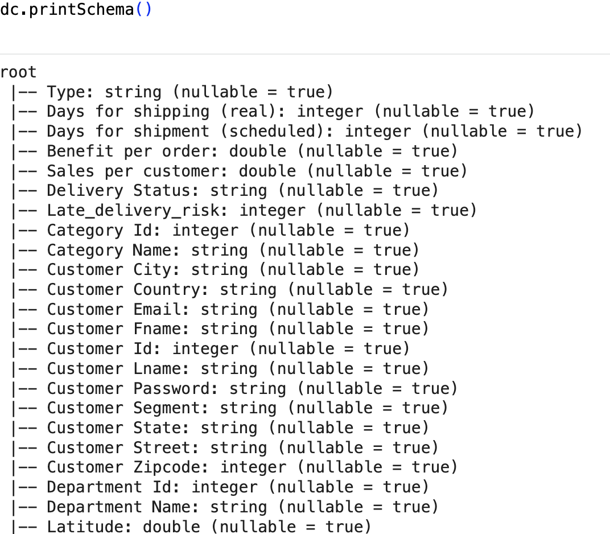

# Late Delivery Risk Prediction for Supply Chain Orders

> End-to-end machine learning project using **PySpark**, **Spark MLlib**, **MongoDB Atlas**, and **Logistic Regression** to predict whether a supply-chain order is at risk of late delivery.


---

## Author

**Aditya Kumar**

Project topic: **Logistic Regression for Supply Chain Late Delivery Risk Prediction**

---

## Technologies Used

| Category | Tools |
|---|---|
| Programming | Python 3.14 / 3.10+ |
| Big Data Processing | PySpark 4.2, Spark SQL |
| Machine Learning | Spark MLlib (Logistic Regression, VectorAssembler, StandardScaler) |
| Web Application | Flask, Jinja2 Templates, REST APIs |
| UI & Visualization | Tailwind CSS, Chart.js, Lucide Icons, Matplotlib, Seaborn |
| Data Analysis | Pandas, NumPy |
| Data Storage | MongoDB Atlas (`Regression_loogistic.preprocessing`) |
| Interactive Notebooks | Google Colab, Jupyter Notebook |
| Dataset Source | Kaggle (DataCo Global Supply Chain) |



---

## Table of Contents

- [Author](#author)
- [Technologies Used](#technologies-used)
- [Project Overview](#project-overview)
- [Business Problem](#business-problem)
- [Dataset](#dataset)
- [Project Architecture](#project-architecture)
- [Repository Contents](#repository-contents)
- [Pipeline Workflow](#pipeline-workflow)
- [Modeling Approach](#modeling-approach)
- [Results](#results)
- [Key Insights](#key-insights)
- [Interactive Web Application & Executive Dashboard](#interactive-web-application--executive-dashboard)
- [How to Run](#how-to-run)
- [Project Screenshots](#project-screenshots)

---

## Project Overview

This project builds a machine learning pipeline to predict **late delivery risk** for a supply-chain company. The workflow starts with downloading the DataCo Supply Chain dataset from Kaggle, loading the data into Google Colab, storing it in MongoDB Atlas, cleaning and transforming the data using PySpark, training a Logistic Regression classifier, and evaluating the model with classification metrics.

The target variable is:

```text
Late_delivery_risk
```

Where:

```text
0 = Not late
1 = Late delivery risk
```

This project demonstrates:

- Data ingestion from Kaggle
- Cloud data storage using MongoDB Atlas
- Large-scale preprocessing with PySpark
- Categorical feature encoding
- Correlation-based feature analysis
- Logistic Regression using Spark MLlib
- Binary classification evaluation
- Reporting and presentation of results

---

## Business Problem

Delivery time is a critical factor in supply-chain and logistics operations. Late deliveries can increase cost, reduce customer satisfaction, and damage business reliability.

The goal of this project is to answer the question:

> **Can we predict whether an order is likely to be delivered late using order, customer, product, and shipping information?**

A reliable late-delivery prediction model can help a company:

- Identify risky orders earlier
- Improve shipment planning
- Prioritize operational attention
- Reduce delivery delays
- Improve customer experience

---

## Dataset

The project uses the **DataCo Supply Chain Dataset** from Kaggle.

Dataset source:

```text
https://www.kaggle.com/datasets/jolenechen/datacosupplychaindataset
```

Dataset size:

| Property | Value |
|---|---:|
| Rows | 180,519 |
| Columns | 53 |
| Target column | `Late_delivery_risk` |
| Problem type | Binary classification |

Example feature groups:

| Group | Example Columns |
|---|---|
| Shipping | `Days for shipping (real)`, `Days for shipment (scheduled)`, `Shipping Mode`, `Delivery Status` |
| Customer | `Customer City`, `Customer Segment`, `Customer State`, `Customer Zipcode` |
| Order | `Order City`, `Order Country`, `Order Region`, `Order Status`, `Order Item Quantity` |
| Product | `Category Name`, `Product Name`, `Product Price`, `Product Status` |
| Financial | `Sales`, `Benefit per order`, `Order Profit Per Order`, `Order Item Discount` |

---

## Project Architecture

The architecture contains three main stages:

1. **Ingestion**: Kaggle dataset is downloaded into Google Colab.
2. **Storage**: Data is exported to MongoDB Atlas.
3. **Modeling**: PySpark is used for preprocessing, feature engineering, model training, and evaluation.


The project ingestion process uses:

- Kaggle dataset
- Google Colab
- MongoDB Atlas

---

## Repository Contents

```text
.
├── DataCoSupplyChainDataset.csv                    # Dataset (180,519 records, 53 columns)
├── Ingestion.ipynb                                 # MongoDB Atlas data ingestion notebook
├── Pyspark_Logistic_Regression_model.ipynb         # Interactive PySpark modeling notebook
├── pyspark_logistic_regression_model.py            # Standalone PySpark ML pipeline script
├── app.py                                          # Flask backend & REST APIs
├── model_metadata.json                             # Exported model weights, scaler & category maps
├── requirements.txt                                # Pinned Python dependencies
├── static/                                         # Frontend static assets
│   ├── css/
│   │   └── style.css                               # Executive dark theme & custom styling
│   └── js/
│       ├── app.js                                  # Global navigation, mobile drawer & state
│       ├── charts.js                               # Delivery trend & coefficient charts
│       ├── predictor.js                            # Form handling & real-time risk diagnostics
│       └── mongo.js                                # Live MongoDB Atlas sample order loader
├── templates/                                      # Modular Jinja2 templates
│   ├── base.html                                   # Master HTML5 skeleton layout
│   ├── index.html                                  # Central view container
│   ├── components/
│   │   ├── header.html                             # Responsive top navbar with hamburger menu
│   │   └── footer.html                             # Minimalist footer
│   └── tabs/
│       ├── overview.html                           # Executive Operations overview dashboard
│       ├── assess.html                             # Full-screen order risk simulator
│       ├── analytics.html                          # Model diagnostics & confusion matrix
│       └── mongodb.html                            # MongoDB Atlas order book explorer
├── assets/
│   ├── correlation_heatmap.png                     # Generated feature correlation matrix
│   └── readme/                                     # Architecture diagrams & figures
└── README.md                                       # Comprehensive project documentation
```

---

## Pipeline Workflow

### 1. Data Ingestion

The dataset is downloaded from Kaggle using `opendatasets`:

```python
import opendatasets as od

od.download("https://www.kaggle.com/datasets/jolenechen/datacosupplychaindataset")
```

Then the data is loaded into a dataframe and inserted into MongoDB Atlas.


### 2. MongoDB Storage

MongoDB Atlas is used as a storage layer for the ingested records.


Example ingestion logic:

```python
from pymongo import MongoClient
import pandas as pd

client = MongoClient(MONGO_URI)
db = client["Regression_logistic"]
collection = db["preprocessing"]

df = pd.read_csv("DataCoSupplyChainDataset.csv", encoding="latin1")
data = df.to_dict(orient="records")
collection.insert_many(data)
```

> Security note: the real MongoDB URI should be stored in an environment variable, not directly inside notebooks or scripts.

### 3. Data Loading with PySpark

```python
from pyspark.sql import SparkSession

spark = SparkSession.builder \
    .master("local[*]") \
    .appName("Supply Chain Late Delivery Prediction") \
    .getOrCreate()

df = spark.read.csv("DataCoSupplyChainDataset.csv", header=True, inferSchema=True)
```

### 4. Data Cleaning

Irrelevant, sensitive, or high-cardinality columns are removed, including:

```text
Customer Email
Customer Password
Customer Street
Product Image
Latitude
Longitude
Product Description
Order Zipcode
Shipping Zipcode
```

Missing values are checked and removed to prepare the dataset for machine learning.

### 5. Feature Encoding

Categorical columns are transformed using:

- `StringIndexer`
- `OneHotEncoder`
- `VectorAssembler`

Example categorical columns:

```text
Type
Delivery Status
Category Name
Customer City
Customer Segment
Market
Order Region
Order Status
Shipping Mode
```

### 6. Feature Engineering

Correlation analysis is used to identify highly correlated and redundant features across the 180,519 order records.



The project removes or avoids duplicated information between fields such as:

| Feature 1 | Feature 2 | Relationship |
|---|---|---|
| `Benefit per order` | `Order Profit Per Order` | Highly correlated |
| `Sales per customer` | `Sales` | Highly correlated |
| `Sales per customer` | `Order Item Total` | Highly correlated |
| `Category Id` | `Product Category Id` | Highly correlated |
| `Customer Id` | `Order Customer Id` | Highly correlated |

### 7. Model Training

The model uses Spark MLlib Logistic Regression:

```python
from pyspark.ml.classification import LogisticRegression

logistic_regression = LogisticRegression(
    featuresCol="trained_advanced_features",
    labelCol="Late_delivery_risk"
)

model = logistic_regression.fit(train_data)
```

The dataset is split into:

```text
80% training data
20% testing data
```

### 8. Evaluation

The model is evaluated using:

- AUC
- Weighted Recall
- F1-score
- Confusion matrix



---

## Modeling Approach

The project uses **Logistic Regression** because the target is binary:

```text
Late_delivery_risk = 0 or 1
```

The main modeling steps are:

1. Remove irrelevant and sensitive columns
2. Handle missing values
3. Convert categorical variables into numerical representations
4. Assemble selected features into a feature vector
5. Scale features using `StandardScaler`
6. Split the data into train and test sets
7. Train Logistic Regression
8. Evaluate predictions

Selected advanced features include:

```python
feature_cols_advanc = [
    "Days for shipping (real)",
    "Days for shipment (scheduled)",
    "Shipping Mode_index",
    "Order Status_index",
    "Type_index",
    "Customer Zipcode",
    "Customer City_index",
    "Order Item Quantity",
    "Department Id",
    "Customer Segment_index",
    "Customer Lname_index",
    "Customer State_index",
]
```

---

## Results

### Model Comparison & Target Leakage Benchmark

Three distinct PySpark MLlib model pipelines were trained and evaluated on 35,793 held-out test orders to assess performance, non-linear capabilities, and real-world operational fit:

| Model Architecture | Algorithm Type | Features | Target Leakage Risk | ROC-AUC | Weighted Recall | F1-Score | Spark Train Time | Operational Fit |
|---|---|:---:|:---:|:---:|:---:|:---:|:---:|---|
| **Logistic Regression (Full)** | Linear / Probabilistic | 12 | High (Days for shipping (real)) | **0.9851** | 97.65% | 0.9765 | 51.3s | Post-dispatch carrier audit & SLA monitoring |
| **Random Forest Classifier** | Ensemble (20 Trees, Depth 7) | 12 | High (Days for shipping (real)) | **1.0000** | 100.00% | 1.0000 | 10.7s | Non-linear validation & carrier verification |
| **Pre-Dispatch Model** | Linear / Production Intake | 11 | **Zero (Strictly intake data)** | **0.7288** | 69.23% | 0.6900 | 5.8s | Order intake routing & warehouse dispatch SLA |

### Target Leakage & Real-World Operations Insight

- **Post-Transit Audit (Full Pipeline)**: The feature Days for shipping (real) is recorded by carriers during actual shipment. Using this feature yields near-perfect classification (ROC-AUC ~0.985 - 1.0), making it ideal for auditing carrier performance, detecting SLA breaches, and triggering customer delivery notifications.
- **Pre-Dispatch Intake SLA**: When scoring an order at the moment of customer checkout or warehouse intake, actual transit time is not yet known. The **Pre-Dispatch Model** excludes this variable and evaluates solely the 11 order-intake attributes (Days for shipment scheduled, Shipping Mode, Order Status, Customer City, Customer State, Segment, etc.), delivering a realistic, leakage-free **0.7288 ROC-AUC** for proactive warehouse expediting.

### Full Pipeline Test Set Confusion Matrix

The primary Logistic Regression model achieved the following confusion matrix on 35,793 test orders:

| Actual Class | Predicted Class 0 (On-Time) | Predicted Class 1 (Late Risk) | Total Actual |
|---|---:|---:|---:|
| **Class 0 (On-Time Delivery)** | **15,772** (TN) | 363 (FP - False Alarm) | 16,135 |
| **Class 1 (Late Delivery Risk)** | 427 (FN - Missed) | **19,231** (TP - Caught) | 19,658 |

- **Accuracy**: 97.8%
- **Precision (Late Deliveries)**: 98.1%
- **Recall (Late Deliveries)**: 97.8% (19,231 of 19,658 late shipments correctly flagged)

---

## Key Insights

1. **Shipping-related variables are highly predictive** of late delivery risk.
2. **Correlation analysis helps reduce duplicated features** and improve feature selection.
3. **PySpark is useful for scaling preprocessing and ML workflows** on larger datasets.
4. **MongoDB Atlas can be used as a cloud storage layer** for the ingested supply-chain data.
5. **Feature leakage must be checked carefully** before using the model in a real production scenario.

---

## Interactive Web Application & Executive Dashboard

The repository includes a modern, production-ready web application built with **Flask**, **Tailwind CSS**, and **Chart.js** that exposes the PySpark machine learning pipeline through an executive operational interface.



### Key Capabilities

1. **Operations Overview (`/`)**:
   - Executive dark & forest green theme designed for logistics control towers.
   - Summary cards displaying **180,519** monitored orders, **56.7%** risk exposure, **0.9847** AUC, and **0.9775** F1-score.
   - Interactive weekly delivery performance trend visualization.

2. **Full-Screen Order Risk Assessor (`Assess Order`)**:
   - **Sub-millisecond Real-Time Inference**: Evaluates the learned PySpark logistic regression weights and standardizer parameters (`model_metadata.json`) without JVM latency.
   - **Dynamic Risk Gauge**: Displays instant late delivery risk percentage, logit score ($z$), and severity level (`ON-TIME EXPECTED` vs `LATE RISK DETECTED`).
   - **Feature Driver Breakdown**: Visualizes the exact log-odds contribution of each feature to the prediction.
   - **Actionable Mitigation Recommendations**: Automatically outputs logistical actions (priority re-routing, carrier escalation, automated customer notifications).
   - **Interactive What-If Sliders & One-Click Presets**: Test standard orders, rush first class, or high-risk delays with live slider recalculation.

3. **Model Intelligence & Analytics (`Model Analytics`)**:
   - Out-of-sample confusion matrix visualizer (35,793 test orders).
   - Horizontal bar chart of learned PySpark feature coefficients (positive risk drivers vs negative risk cushions).
   - Embedded high-resolution correlation matrix heatmap viewer (`assets/correlation_heatmap.png`).

4. **MongoDB Atlas Cloud Hub (`Order Book`)**:
   - Live cluster connection monitor to `late-prediction.gqirgaw.mongodb.net`.
   - Real-time order table querying documents directly from `Regression_loogistic.preprocessing` (180,519 documents).

5. **Responsive Navigation**:
   - Clean top navbar pills on desktop screens.
   - Responsive hamburger menu (`☰`) with animated cross toggle (`✕`) on tablets and mobile screens.

---

## How to Run

### 1. Clone the repository

```bash
git clone <your-repository-url>
cd late-delivery-risk-prediction
```

### 2. Create a virtual environment

```bash
python -m venv .venv
source .venv/bin/activate
```

### 3. Install dependencies

```bash
pip install -r requirements.txt
```

If using Google Colab, install the required packages inside the notebook:

```python
!pip install opendatasets pymongo pyspark findspark
```

### 4. Download the dataset

The dataset can be downloaded from Kaggle:

```text
https://www.kaggle.com/datasets/jolenechen/datacosupplychaindataset
```

Place the CSV file in the project root or update the file path inside the notebook/script.

### 5. Configure MongoDB securely

Create a `.env` file locally:

```env
MONGO_URI=mongodb+srv://<username>:<password>@<cluster-url>/?appName=<app-name>
```

Do **not** commit `.env` to GitHub.

### 6. Run the notebooks / scripts

Recommended order:

```text
1. Ingestion.ipynb (or export_to_mongodb helper)
2. pyspark_logistic_regression_model.py
```

### 7. Launch the Interactive Web Dashboard

To run the real-time web application with interactive order prediction, what-if simulations, and live MongoDB Atlas integration:

```bash
python app.py
```

Open your browser at: `http://127.0.0.1:5000`


---

## Project Screenshots

### Executive Operations Dashboard


### Real-Time Order Risk Assessor



### PySpark Feature Correlation Heatmap


### Dataset Overview & Architecture




